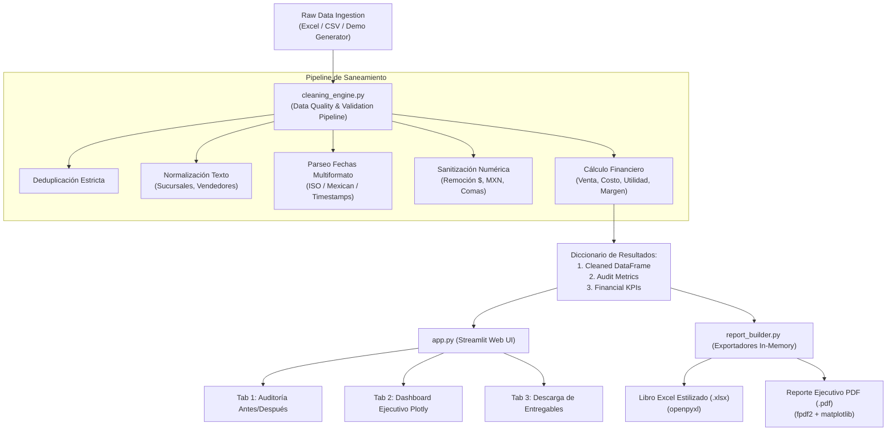

# AutoReport PyME 🇲🇽 📊

> **Plataforma de Ingeniería de Datos, Auditoría Transaccional y Automatización de Reportes Ejecutivos para Pequeñas y Medianas Empresas en México.**  
> *Data Engineering, Transactional Auditing, and Automated Executive Reporting Platform for Mexican SMEs.*

---

## 🌐 Resumen del Proyecto / Project Overview

### 🇪🇸 Español
En el ecosistema empresarial de las PyMEs mexicanas, una gran parte de las operaciones comerciales, inventarios y cobranzas se gestionan mediante hojas de cálculo manuales de Excel. Esto genera errores recurrentes: registros duplicados, fechas en formatos incompatibles (ISO vs. DD/MM/AAAA), nombres de sucursales o vendedores con tipografía desalineada (`" monterrey "`, `"CDMX   "`) y cifras numéricas viciadas con símbolos de texto (`"$1,500.00 MXN"`).

**AutoReport PyME** resuelve esta problemática de raíz mediante una arquitectura robusta de ingeniería de datos en Python:
1. **Audita y depura** automáticamente los archivos transaccionales sin intervención humana.
2. **Estandariza catálogos**, homologa fechas y calcula métricas financieras clave (*Venta Total, Costo, Utilidad Bruta y Margen %*).
3. **Presenta un Dashboard Comercial interactivo en Streamlit** con comparativas *Antes/Después* y visualizaciones dinámicas en Plotly.
4. **Genera entregables directivos 100% en memoria**: un libro de Excel estilizado con `openpyxl` y un informe ejecutivo formal en PDF de 2 páginas con `fpdf2` y `matplotlib`.

---

### 🇺🇸 English
In Mexican small and medium-sized enterprises (SMEs/PyMEs), sales and operational records are overwhelmingly handled via manual Excel spreadsheets. This leads to persistent data quality defects: duplicated rows, conflicting date formats (ISO vs. DD/MM/YYYY), inconsistent branch and salesperson casing (`" monterrey "`, `"CDMX   "`), and corrupted numeric entries containing currency symbols (`"$1,500.00 MXN"`).

**AutoReport PyME** solves this challenge through a production-grade Python data engineering pipeline:
1. **Audits and sanitizes** transactional spreadsheets automatically.
2. **Normalizes master catalogs**, standardizes dates, and derives critical financial KPIs (*Gross Revenue, Cost of Goods Sold, Gross Profit, and Margin %*).
3. **Delivers an interactive Streamlit commercial dashboard** featuring *Before/After* audit comparisons and Plotly visualizations.
4. **Builds executive-ready deliverables in-memory**: a professionally styled Excel workbook (`openpyxl`) and a 2-page C-level PDF report (`fpdf2` + `matplotlib`).

---

## 🏗️ Arquitectura de la Solución / Solution Architecture



---

## 📁 Estructura del Repositorio / Repository Structure

```text
AutoReport_PyME/
│
├── requirements.txt         # Dependencias principales del proyecto
├── sample_generator.py      # Generador sintético con vicios intencionales (~300 filas)
├── cleaning_engine.py       # Motor de limpieza, auditoría y cálculo de métricas financieras
├── report_builder.py        # Generador en memoria de Excel (openpyxl) y PDF (fpdf2)
├── test_autoreport.py       # Suite completa de pruebas unitarias (unittest)
├── app.py                   # Dashboard comercial interactivo con Streamlit y Plotly
├── .gitignore               # Exclusiones estándar de Git para entornos Python
└── README.md                # Documentación ejecutiva y técnica bilingüe
```

---

## ⚙️ Módulos y Especificaciones Técnicas / Technical Specifications

### 1. `sample_generator.py`
- Genera ~300 transacciones representativas del mercado mexicano con catálogo comercial:
  - **Sucursales**: Monterrey, Guadalajara, CDMX.
  - **Vendedores**: Equipo comercial mexicano (Ana Sofía Garza, Carlos Mendoza, etc.).
  - **Categorías**: Electrónica y Cómputo, Mobiliario de Oficina, Papelería Corporativa, Insumos y Limpieza, Seguridad Industrial.
- Inyecta intencionalmente anomalías de calidad de datos:
  - Duplicados exactos.
  - Casing y espacios irregulares (`" monterrey "`, `"CDMX   "`).
  - Fechas mixtas (`2024-03-15`, `15/03/2024`, `04-18-2024`, textos como `"PENDIENTE"`).
  - Celdas vacías (`None`, `np.nan`).
  - Textos en columnas monetarias (`"$ 12,450.00 MXN"`).

### 2. `cleaning_engine.py`
- **Fase de Auditoría**: Cuantifica duplicados, celdas nulas y calcula la tasa de retención.
- **Fase de Deduplicación**: Purga registros repetidos idénticos.
- **Fase de Estandarización**: Convierte sucursales a catálogo canónico y homologa texto.
- **Fase Cronológica**: Convierte fechas a datetime nativo mediante algoritmos multiformato.
- **Fase Financiera**: Calcula:
  $$\text{Venta Total} = \text{Cantidad} \times \text{Precio Unitario}$$
  $$\text{Costo Total} = \text{Cantidad} \times \text{Costo Unitario}$$
  $$\text{Utilidad} = \text{Venta Total} - \text{Costo Total}$$
  $$\text{Margen \%} = \left(\frac{\text{Utilidad}}{\text{Venta Total}}\right) \times 100$$

### 3. `report_builder.py`
- **Excel Corporativo (`openpyxl`)**:
  - Hojas: *Resumen Ejecutivo*, *Transacciones Limpias* y *Analítica por Sucursal*.
  - Formato numérico de moneda (`$#,##0.00`), porcentajes (`0.0%`), fechas ISO y zebra-striping.
  - Autoajuste dinámico de anchos de columna.
- **Reporte Ejecutivo PDF (`fpdf2` + `matplotlib`)**:
  - Encabezado y pie de página corporativos con franja azul directiva.
  - Tablas de indicadores clave y diagnóstico de auditoría de datos.
  - 2 gráficos vectoriales incrustados a 250 DPI (Ventas por Sucursal y Top Categorías).
  - Sanitización para compatibilidad universal sin errores de codificación.

### 4. `app.py`
- Desarrollado en **Streamlit** con diseño responsivo y estética corporativa.
- Barra lateral para carga de datos demo con un clic o subida de archivos propios (.xlsx, .csv).
- 3 Pestañas de análisis:
  - **Pestaña 1 (Auditoría)**: Comparación lado a lado de datos crudos vs. limpios y bitácora de anomalías corregidas.
  - **Pestaña 2 (Dashboard)**: KPIs dinámicos, filtros por sucursal/categoría y 4 gráficos interactivos con Plotly.
  - **Pestaña 3 (Descargas)**: Botones de exportación directa en memoria de los entregables Excel y PDF.

---

## 🚀 Guía de Instalación y Uso / Installation & Usage Guide

### 1. Clonar el Repositorio / Clone the Repository
```bash
git clone https://github.com/tu-usuario/AutoReport_PyME.git
cd AutoReport_PyME
```

### 2. Crear y Activar Entorno Virtual / Create & Activate Virtual Environment
```bash
# En Windows (PowerShell)
python -m venv .venv
.\.venv\Scripts\Activate.ps1

# En Linux / macOS
python3 -m venv .venv
source .venv/bin/activate
```

### 3. Instalar Dependencias / Install Dependencies
```bash
pip install -r requirements.txt
```

### 4. Ejecutar las Pruebas Unitarias / Run Unit Tests
```bash
python -m unittest test_autoreport.py -v
```

### 5. Iniciar el Dashboard en Streamlit / Launch Streamlit App
```bash
streamlit run app.py
```
Abre tu navegador en `http://localhost:8501` para interactuar con la aplicación.

---

## 🧪 Cobertura de Pruebas Unitarias / Unit Testing Coverage

El archivo `test_autoreport.py` valida rigurosamente:
1. **`TestSampleGenerator`**: Mínimo de filas generadas, presencia de columnas y presencia comprobable de duplicados, nulos y textos desalineados.
2. **`TestCleaningEngine`**: Deduplicación efectiva, remoción de nulos críticos, canonicidad de sucursales (`Monterrey`, `Guadalajara`, `CDMX`) y exactitud matemática de fórmulas financieras.
3. **`TestReportBuilder`**: Verificación binaria de archivos Excel (.xlsx abierto con openpyxl) y validación de cabecera mágica `%PDF` en reportes generados.

---

## 📄 Licencia / License
Distribuido bajo la Licencia MIT. Consulta el archivo `LICENSE` para mayores detalles.
